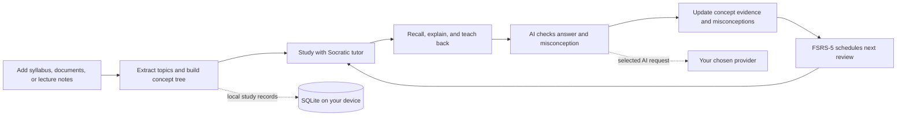

# Neuron

<p align="center">
  <strong>Learn deeply. Remember longer.</strong><br>
  A private, AI-powered desktop workspace for active learning and spaced repetition.
</p>

<p align="center">
  <a href="https://github.com/robcarlson006/neuron/releases/tag/v5.5.0"></a>
  
  
  
  
  
  
  <a href="LICENSE"></a>
</p>

Neuron turns your course materials into a guided learning system. Study with a Socratic AI tutor, organize a syllabus into a trackable curriculum, and revisit concepts when they are due—all in a desktop app with local SQLite storage.

> [!TIP]
> New to Neuron? Download the installer for your platform below, then add a subject and start a tutor session. Your study data stays on your device.

## What you can do with Neuron

| Study workflow | How it helps |
| --- | --- |
| **Socratic active-recall tutor** | Learn from one or several selected documents in a unified tutor session. Each turn asks you to retrieve and apply an idea, detects misconceptions, adapts its scaffolding, and records evidence across stable curriculum concepts. |
| **Smart syllabus and curriculum** | Import documents, PDFs, or syllabus material. Neuron extracts a concept tree, then tracks concepts across multi-turn study sessions so progress reflects understanding rather than page count. |
| **FSRS-5 spaced repetition** | Schedule reviews around predicted memory, with confidence tracking and open-ended active-recall prompts. AI semantic grading evaluates the meaning of your answer and returns useful feedback. |
| **Audio lecture notes** | Capture lecture audio and work with subject notes using AI assistance to organize and revisit key ideas. |
| **Bring your own AI** | Connect a supported provider such as DeepSeek or OpenAI, or use an Ollama/local model. Choose the provider and key that fit your workflow. |

## How Neuron works



Your subject material and learning history are managed locally. When you configure a hosted AI provider, the relevant prompt or content is sent to that provider to generate assistance; provider privacy and retention policies apply. With a local Ollama model, inference can stay on your machine.

### A learning loop built around understanding

1. **Map the material.** Import a syllabus or study document and turn it into a structured set of concepts.
2. **Work one idea at a time.** The tutor explains briefly, then prompts active recall on every turn.
3. **Respond in your own words.** Semantic grading checks the reasoning, surfaces misconceptions, and adjusts support to your level.
4. **Show mastery.** Explain the concept back; Neuron tracks confidence and understanding across the session.
5. **Return at the right time.** FSRS-5 schedules open-ended review to support durable recall.

## Downloads

Get the latest release from [GitHub Releases](https://github.com/robcarlson006/neuron/releases/latest). Version **5.5.0** installers:

| Platform | Installer | Notes |
| --- | --- | --- |
| macOS Apple Silicon | [Neuron-5.5.0-arm64.dmg](https://github.com/robcarlson006/neuron/releases/download/v5.5.0/Neuron-5.5.0-arm64.dmg) | M-series Macs |
| macOS Intel | [Neuron-5.5.0.dmg](https://github.com/robcarlson006/neuron/releases/download/v5.5.0/Neuron-5.5.0.dmg) | Intel Macs |
| Windows | [Neuron Setup 5.5.0.exe](https://github.com/robcarlson006/neuron/releases/download/v5.5.0/Neuron.Setup.5.5.0.exe) | 64-bit installer |
| Linux | [Neuron-5.5.0.AppImage](https://github.com/robcarlson006/neuron/releases/download/v5.5.0/Neuron-5.5.0.AppImage) | x64 AppImage |

> [!NOTE]
> If an asset link is not available yet, open the [v5.5.0 release page](https://github.com/robcarlson006/neuron/releases/tag/v5.5.0) to see the published downloads.

### macOS: Gatekeeper

Neuron is distributed without Apple notarization. If Gatekeeper blocks the downloaded app, move it to Applications, then remove the quarantine attribute:

```bash
xattr -cr /Applications/Neuron.app
```

Launch Neuron from Applications. You can also Control-click the app, choose **Open**, and confirm the prompt.

### Windows: SmartScreen

Windows SmartScreen may show **Windows protected your PC** for an unsigned installer. Select **More info**, then **Run anyway** if you downloaded Neuron from the official release page.

### Linux: AppImage

Make the file executable, then launch it:

```bash
chmod +x Neuron-5.5.0.AppImage
./Neuron-5.5.0.AppImage
```

## Quick start

### For learners

1. Download and install Neuron for your operating system.
2. Launch the app and create or open a subject.
3. Add a syllabus, PDF, or other study material to build your curriculum.
4. Start a tutor session or review concepts due today.
5. Add an AI provider key in settings for AI-assisted tutoring, grading, and notes. Provider keys are yours to supply.

### For developers

**Requirements:** Node.js 20 or newer and npm.

```bash
git clone https://github.com/robcarlson006/neuron.git
cd neuron
npm install
npm run dev
```

Build the app and install the macOS Apple Silicon build into `/Applications`:

```bash
npm run build
npm run install-app
```

`npm run install-app` is a convenience script for macOS Apple Silicon. Create platform installers with `npm run build:mac`, `npm run build:win`, or `npm run build:linux`; output is written to `dist/`.

## Privacy and AI providers

- **Local by default:** Subjects, notes, and study progress are stored in a local SQLite database. No Neuron account is required.
- **Bring your own key:** Configure your own provider credentials; Neuron does not bundle a shared API key.
- **Provider choice:** Use supported hosted providers such as DeepSeek and OpenAI, or connect a local model through Ollama.
- **You control hosted requests:** AI features send the content needed for the request to the provider you select. Review that provider's terms and privacy policy before use.

Database locations:

| OS | Location |
| --- | --- |
| macOS | `~/Library/Application Support/studyhelper/studyhelper.db` |
| Linux | `~/.config/studyhelper/studyhelper.db` |
| Windows | `%APPDATA%\studyhelper\studyhelper.db` |

## Built with

| Layer | Technology |
| --- | --- |
| Desktop | Electron, React, TypeScript |
| Build | Vite, electron-vite |
| Styling | Tailwind CSS |
| Local persistence | SQLite via `better-sqlite3` |
| Review scheduling | FSRS-5 |
| AI integration | Provider-based, bring-your-own-key setup |

Neuron is released under the [MIT License](LICENSE).
